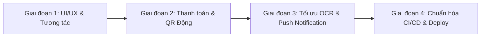

# BÁO CÁO PHÂN TÍCH VÀ ĐỀ XUẤT NÂNG CẤP REPOSITORY SMARTPARK

> **Ngày thực hiện:** Tháng 11/2026  
> **Dự án:** [SmartPark](file:///d:/Files/SmartPark)  
> **Bộ kỹ năng áp dụng:**
> - `appllama-app-design-skill` (Thiết kế & Trải nghiệm Native Mobile)
> - `code-review` & `ponytail` (Đánh giá kiến trúc, Clean Architecture, Tính tối giản & Tinh gọn)
> - `design-taste-frontend` & `high-end-visual-design` (Thẩm mỹ & Trải nghiệm Web Admin)
> - `archify` (Phân tích hệ thống kiến trúc & luồng dữ liệu)

---

## 1. TỔNG QUAN HIỆN TRẠNG REPOSITORY

Dự án **SmartPark** là một hệ thống đặt chỗ và quản lý bãi đỗ xe thông minh gồm 3 thành phần chính:
1. **Ứng dụng Mobile (Flutter):**
   - Phân tách 2 flavor: `customer` (Khách hàng tìm kiếm, đặt chỗ xe) và `staff` (Nhân viên soát vé vào/ra, quét QR, OCR biển số xe on-device bằng Google ML Kit).
   - Tích hợp SQLite/Drift phục vụ cơ chế **Offline-First**, lưu hàng đợi (outbox) và đồng bộ khi có kết nối mạng.
2. **Web Quản trị (React + TypeScript + Vite):**
   - Dành cho Owner/Admin quản lý danh sách bãi xe, sơ đồ chỗ đỗ, biểu phí theo giờ, phân quyền nhân viên và theo dõi doanh thu.
3. **Backend & Cơ sở dữ liệu (Supabase):**
   - PostgreSQL với 11 bảng Row-Level Security (RLS), transaction/RPC đảm bảo tính toàn vẹn dữ liệu và cơ chế realtime trigger.

### Các điểm cộng lớn hiện tại:
- **Kiến trúc mạch lạc:** Code Flutter phân tầng theo Clean Architecture (`domain`, `data`, `presentation`, `core`), quản lý state bằng Riverpod.
- **Tính năng Offline-First thiết thực:** Nhân viên vẫn có thể check-in/check-out khi mất mạng nhờ SQLite cục bộ và cơ chế giải quyết xung đột khi đồng bộ.
- **Bảo mật cơ sở:** Đã cấu hình RLS chặt chẽ trên Supabase, không để lộ key đặc quyền (`service_role`) ở client.

---

## 2. NHỮNG ĐIỂM CẦN CẢI THIỆN ĐỂ TĂNG TÍNH TIỆN LỢI & PHÙ HỢP THỰC TẾ

### 2.1. Trải nghiệm Mobile (Theo chuẩn `appllama-app-design-skill`)
* **Thiếu phản hồi xúc giác (Haptic Feedback) & Trực quan khi quét OCR/QR:**
  - Khi nhân viên dùng camera quét QR hoặc chụp biển số, việc thiếu `HapticFeedback.lightImpact()` / `selectionClick()` làm giảm cảm giác tương tác thật.
  - Khung quét camera chưa có hiệu ứng HUD/radar animation hoặc chỉ dẫn khoảng cách tối ưu (quá gần / quá xa / thiếu sáng).
* **Luồng chọn thời gian & Đặt chỗ (Time & Slot Selection):**
  - Đang dùng các dialog `showDatePicker` / `showTimePicker` mặc định của Flutter. Đối với ứng dụng đặt xe nhanh, các picker này tốn nhiều thao tác (tap -> chọn giờ -> tap chuyển phút -> bấm OK).
  - *Giải pháp:* Chuyển sang dạng **Cupertino/Wheel picker trượt** hoặc **khối khung giờ chọn nhanh (Quick-chips: 1h, 2h, 4h, cả ngày)** kết hợp timeline trượt trực quan.
* **Sơ đồ bãi xe (Slot Grid / Interactive Map):**
  - Sơ đồ chỗ đỗ hiện tại hiển thị danh sách tĩnh/bán tương tác, chưa trực quan về không gian thực (hướng cổng vào, vị trí cột, ô xe hơi vs ô xe máy, ô cho xe điện sạc EV).
* **Micro-interactions:**
  - Chưa có skeleton loading đồng bộ khi mạng chập chờn; quá trình chuyển trang giữa danh sách bãi và chi tiết bãi đỗ chưa tận dụng `Hero` animation.

---

### 2.2. Trải nghiệm Web Admin (Theo chuẩn `design-taste-frontend` & `high-end-visual-design`)
* **Giao diện mang hơi hướng Prototype / CSS thủ công:**
  - Thư mục `admin-web` đang dùng một file CSS khổng lồ (`styles.css` > 2100 dòng) với nhiều quy tắc viết tay, thiếu hệ thống Design Token hiện đại (chưa tận dụng Tailwind CSS hoặc Radix UI/shadcn).
  - Màu sắc và độ tương phản đang ở mức cơ bản, thiếu sự phân cấp phân tầng chiều sâu (elevation, subtle borders, card hover state).
* **Trực quan hóa Dữ liệu (Data Visualization):**
  - Các biểu đồ doanh thu và tỷ lệ lấp đầy (`live-charts.tsx`) là SVG vẽ thủ công dạng bán tĩnh, chưa có tooltip hover chi tiết, chưa hỗ trợ lọc linh hoạt theo dải ngày (Date-range picker chuyên sâu) và so sánh tăng trưởng kỳ trước (DoD / MoM).
* **Trải nghiệm Responsive trên bảng dữ liệu lớn:**
  - Mặc dù có media query cho tablet, nhưng bảng dữ liệu lớn (bảng vé, bảng lịch sử xe) chưa có tính năng sticky header, ghim cột hành động (fixed action column) hoặc ẩn/hiện cột thông minh.

---

### 2.3. Nghiệp vụ Thực tế & Khả năng Vận hành (Business Logic)
* **Phương thức thanh toán:**
  - Hiện tại chỉ hỗ trợ **tiền mặt (cash)**. Trong thực tế các bãi đỗ xe thông minh cần tích hợp cổng thanh toán trực tuyến:
    - **VietQR / SePAY / MoMo / VNPay:** Tự động sinh mã QR động chứa số tiền và mã vé để khách quét trả ngay khi xe tới barie.
    - Webhook thông báo xe đã thanh toán để barie tự mở hoặc app nhân viên tự động nhảy trạng thái `paid`.
* **Push Notification (FCM / OneSignal):**
  - Ứng dụng mới chỉ có thông báo in-app. Cần bổ sung Firebase Cloud Messaging (FCM) để:
    - Báo cho khách khi sắp hết giờ gửi xe (trước 15 phút).
    - Cảnh báo xe đã check-in thành công hoặc bị tính phụ phí quá giờ.
* **Cải thiện độ chính xác OCR Biển số xe Việt Nam:**
  - Hiện tại ML Kit dùng Latin OCR model chuẩn. Biển số xe Việt Nam thường có 2 dòng (ví dụ `29-A1 / 123.45` hoặc `51F / 678.90`), dễ bị nhầm lẫn giữa chữ `O` và số `0`, `B` và `8`, dấu gạch ngang và dấu chấm.
  - Cần bộ tiền xử lý ảnh (Crop ROI, binarization/ngưỡng sáng) và hàm chuẩn hóa Regex biển số Việt Nam chặt chẽ hơn.

---

### 2.4. Mã nguồn & CI/CD (Theo chuẩn `ponytail` & `code-review`)
* **Chưa có Docker Compose / Local Dev Environment:**
  - Để chạy thử, lập trình viên phải tự cài Flutter, Node, và nối Supabase Cloud. Cần bổ sung file `docker-compose.yml` để chạy Supabase Local hoặc server dev với 1 lệnh `docker compose up`.
* **Fastlane & Secrets Release chưa hoàn thiện:**
  - Các script build ký tự động trong `.github/workflows/` đang ở dạng template mẫu, chưa được thiết lập keystore automation và chưa cấu hình tạo changelog tự động.

---

## 3. LỘ TRÌNH ĐỀ XUẤT CẢI THIỆN (ACTIONABLE ROADMAP)

| Mức ưu tiên | Hạng mục | Giải pháp đề xuất |
| :---: | :--- | :--- |
| **P0** | **Tối ưu Form chọn giờ & Đặt chỗ** | Thay DatePicker dialog bằng Time Slot selector dạng thẻ ngang (Slot chips 1h, 2h, 4h, Tùy chỉnh). Thêm thanh trượt thời gian trực quan. |
| **P0** | **Hiện đại hóa Admin UI** | Tái cấu trúc `styles.css` sang Tailwind/CSS Modules; áp dụng font sans hiện đại, bảng dữ liệu hỗ trợ tìm kiếm/lọc đa tiêu chí, phân trang server. |
| **P1** | **Tích hợp VietQR Thanh toán** | Tạo mã VietQR động theo chuẩn Napas247 chứa nội dung chuyển khoản tự động đối soát thanh toán. |
| **P1** | **Haptic Feedback & OCR HUD** | Thêm khung định vị biển số (HUD overlay) với animation quét radar; rung nhẹ khi nhận diện thành công mã biển số. |
| **P2** | **Cơ chế Push Notification (FCM)** | Tích hợp FCM thông báo nhắc giờ hết hạn đặt chỗ, tránh tình trạng khách quên gây ùn tắc bãi. |
| **P2** | **Dockerize Dev Environment** | Viết file cấu hình chạy Supabase CLI / Docker cục bộ để dev không bị phụ thuộc hoàn toàn vào Cloud. |

---

## 4. KẾT LUẬN

SmartPark là một dự án có **nền tảng kỹ thuật và cấu trúc thư mục rất tốt** (đã tách lớp Clean Architecture, có bảo mật RLS, có offline cache). Những điểm cần cải thiện cốt lõi tập trung vào **tính tiện lợi khi sử dụng hàng ngày (UX), trải nghiệm thẩm mỹ cao cấp cho Admin Web, và tích hợp thanh toán tự động (VietQR)** để biến dự án từ một sản phẩm chuẩn đồ án/thử nghiệm thành một hệ thống thực tế hoàn chỉnh có thể vận hành trơn tru.

